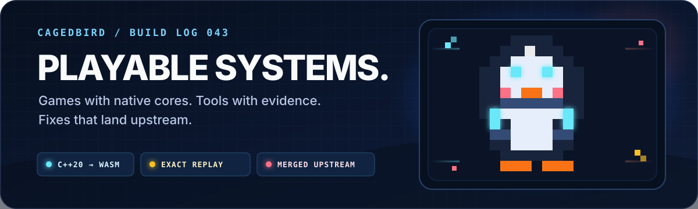
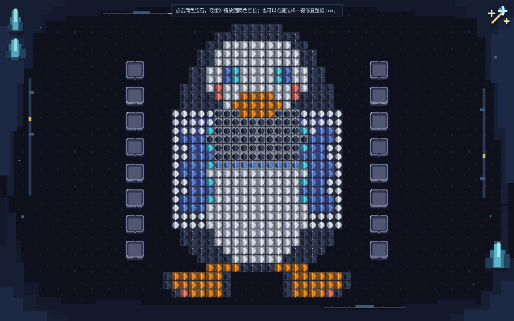

  

  <strong>I turn ambiguous product problems into deterministic, inspectable software—then ship the demo, harness, test gates, and production path around it.</strong>
   
  把模糊问题做成可玩成品，也把核心、验证链和上线证据一起交付。

  
  
  
  

## Current flagship · Brilliant Sort

  

**A deterministic, playable gem puzzle—not a mockup.** The browser drives a headless C++20 core compiled to WebAssembly; TypeScript remains only as an independent differential oracle.

**Proof, not claims:** `546 active sockets` · `C++20 → WebAssembly` · `TS ↔ native ↔ WASM parity` · `22 browser runs / 11 scenarios`

**[Play the production build →](https://brilliant-sort.cagedbird.cn/)** · [Read the evidence matrix](https://github.com/cagedbird043/brilliant-sort/blob/main/submission/evidence-matrix.md)

The same repository owns the puzzle core, replay harness, responsive game stage, semantic pixel-asset pipeline, C++ AudioWorklet synth, CI gates, and atomic static deployment. The point is not just that it runs—it is that every important claim has an executable proof.

## Upstream work that landed

- **KDE Connect** · `2 merged first-contribution MRs` — desktop transfer-port timeout ([!965](https://invent.kde.org/network/kdeconnect-kde/-/merge_requests/965) · [commit](https://github.com/KDE/kdeconnect-kde/commit/94baac4b28589260b2348cbc0980711c83aba9ea)) and Android loopback transport support ([!650](https://invent.kde.org/network/kdeconnect-android/-/merge_requests/650) · [commit](https://github.com/KDE/kdeconnect-android/commit/bfab7c89496055914240b6d8c3541140b853aeeb)).
- **[Oh My Pi](https://github.com/can1357/oh-my-pi)** · `9 merged PRs` — credential lifecycle, provider reliability, Gemini streams, and CJK-aware context handling.
- **More public upstream** · `23 landed changes` — Sub2API, PIPA, FreeLLMAPI, AnySearch Skill, and sing-tun.

  

## Selected systems

- **[fcm-hosts-next](https://github.com/cagedbird043/fcm-hosts-next)** — Go generator and publisher for direct Google push connectivity. **54 stars · 6 forks**
- **[Prismloom](https://github.com/cagedbird043/Prismloom)** — Agent-native pixel asset production across Web, Bun CLI, deterministic local processing, and a hosted job engine.
- **[cjk-visual-context-bench](https://github.com/cagedbird043/cjk-visual-context-bench)** — Open, reproducible benchmark for dense CJK visual-context bitmap compression.
- **[skills](https://github.com/cagedbird043/skills)** — Zero-dependency Go skill manager for GitHub-hosted agent workflows.

  

  Build the whole loop. Keep the evidence close.

